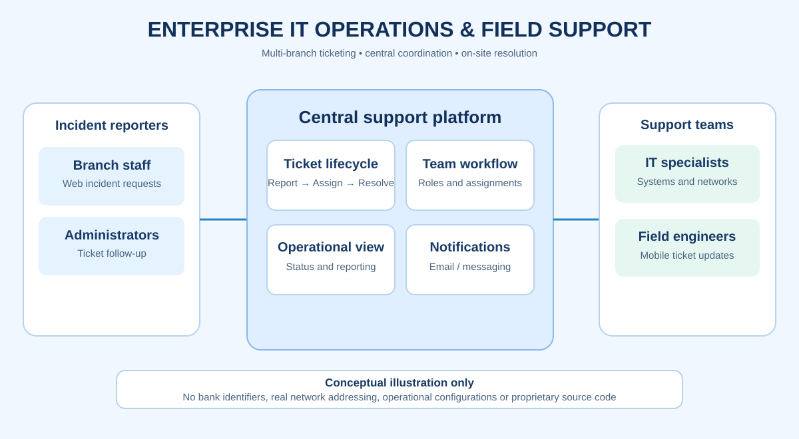

# Enterprise IT Operations Platform

## 🔐 Confidential Notice
This system was designed and implemented for a regulated enterprise environment in the financial services sector.  
No production data, credentials, or internal infrastructure details are disclosed.

---
## Architecture overview (conceptual)

The diagram illustrates ticket reporting by branch employees, centralized IT operations and assignment, and field-engineer resolution workflows. It is illustrative only and does not expose production infrastructure, organization identifiers or internal technical configurations.

## 🧠 Overview

Enterprise IT Operations Platform designed to support multi-branch operations and centralized IT service management in a regulated financial environment.

The system enables incident tracking, service coordination, and operational visibility across distributed teams.

---
## 🧭 Business Context

The platform was developed to address operational inefficiencies in distributed IT environments, enabling structured service delivery and improved coordination between technical teams and business stakeholders.

---

## 🚀 Engineering Impact

The system introduced a unified operational model that improved coordination, reduced response delays, and increased visibility across IT operations in a distributed enterprise environment.

---

## 📊 Scope & Scale

The platform was designed to support enterprise-scale operations across multiple distributed branches within a regulated financial environment, ensuring high availability and operational continuity.

---

## 🧩 System Design Approach

The system was designed using modular architecture principles to ensure scalability, maintainability, and separation of concerns across service layers.

---

## 🎯 Key Capabilities

- IT Service Management (Ticketing & Incident Tracking)
- Multi-branch operational coordination
- Role-based access control (RBAC)
- Automated notifications and workflow management
- Real-time operational dashboard

---

## 🏗 Architecture (High-Level Design)

- Backend: Node.js (Express.js) – Modular API architecture
- Frontend: React.js – Component-based UI design
- Database: PostgreSQL – Relational data model
- Infrastructure: Cloud-based deployment environment
- Authentication: JWT-based secure access model
- Reverse Proxy: Nginx for traffic management and routing

---

## 📱 Mobile & Field Operations

A cross-platform mobile application built with Flutter was developed to support field engineers and operational teams, enabling real-time incident visibility and operational responsiveness.

---

## 📡 Integrations

- Email-based notifications (SMTP/IMAP)
- Messaging integration for alerts
- REST API-based architecture

---

## 🚀 Impact

- Improved operational efficiency across distributed IT teams
- Centralized incident management and tracking
- Standardized IT service workflows
- Enhanced visibility for decision-making

---

## 👨‍💻 Role

Enterprise Infrastructure & Operations Lead

Responsible for system architecture, deployment strategy, and IT operations design.

---

## 🔒 Security Note

All sensitive production details, configurations, and organizational identifiers have been intentionally removed for security reasons.
